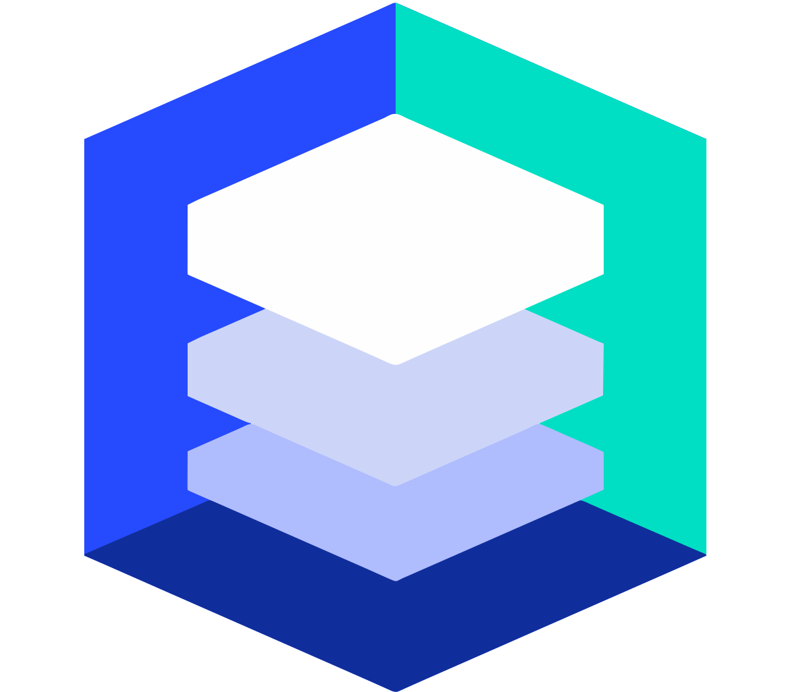

# Hi, I'm Akkarapon Phikulsri 👋

**Software Engineer · Backend & Distributed Systems**
Go · C# · TypeScript · PostgreSQL · Kafka · Cloud

---

## About me

I own systems end to end: requirements, design, implementation, integration, and production support. I build reliable backends and help teams ship them.

- 🛠️ **Build** — REST, GraphQL, gRPC, and WebSocket APIs; microservices; event streaming with Kafka and Redpanda; workflow orchestration.
- 🧱 **Design** — Clean and Hexagonal Architecture, with a focus on maintainability, data correctness, and performance.
- 🔍 **Operate** — Incident investigation, log and data analysis, and integration debugging in production.
- 🤝 **Collaborate** — Scrum and Kanban teams, working closely with business, frontend, and infrastructure. I get productive quickly in unfamiliar codebases and domains.

## Tech stack

| Area | Tools |
|---|---|
| Languages | Go, C#, TypeScript |
| Data | PostgreSQL, SQL Server |
| Messaging | Kafka, Redpanda |
| APIs | REST, GraphQL, gRPC, WebSocket |

## Featured projects

**[Panda Suite](https://github.com/akkaraponph/panda-suite)** — *Agent skills for engineering and product delivery.*
Independent Agent Skills that guide AI coding agents through planning, implementation, review, debugging, testing, and documentation.

**[DeltaView](https://deltaview.refactorroom.com/)** — *See the difference.*
A fast, privacy-first toolkit to compare, visualize, format, and validate JSON. Everything runs in your browser; your files never leave your machine.

 

## GitHub activity

  

  <picture>
    <source media="(prefers-color-scheme: dark)" srcset="https://raw.githubusercontent.com/akkaraponph/akkaraponph/output/github-snake-dark.svg" />
    <source media="(prefers-color-scheme: light)" srcset="https://raw.githubusercontent.com/akkaraponph/akkaraponph/output/github-snake.svg" />
    
  </picture>

## Support

